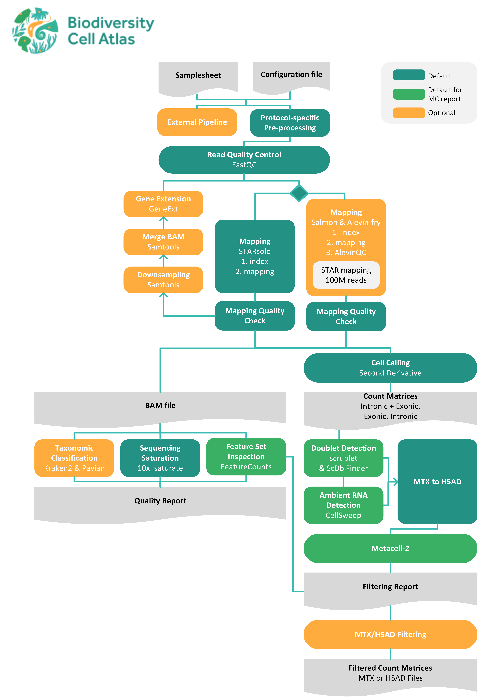

# BCA Pre-Processing Pipeline

[![website][]][website-link]
[![nextflow][]][nextflow-link]
[![conda][]][conda-link]
[![docker][]][docker-link]
[![singularity][]][singularity-link]

[website]: https://img.shields.io/badge/website-biodiversitycellatlas.org-blue
[website-link]: https://biodiversitycellatlas.org
[nextflow]: https://img.shields.io/badge/version-%E2%89%A525.04.0-green?style=flat&logo=nextflow&logoColor=white&color=%230DC09D&link=https%3A%2F%2Fnextflow.io
[nextflow-link]: https://www.nextflow.io/
[conda]: http://img.shields.io/badge/run%20with-conda-3EB049?labelColor=000000&logo=anaconda
[conda-link]: https://docs.conda.io/en/latest/
[docker]: https://img.shields.io/badge/run%20with-docker-0db7ed?labelColor=000000&logo=docker
[docker-link]: https://www.docker.com/
[singularity]: https://img.shields.io/badge/run%20with-singularity-1d355c.svg?labelColor=000000
[singularity-link]: https://sylabs.io/docs/

## Table of Contents

1. [Overview](#overview)
2. [Installation](#installation)
3. [Quick Setup](#quick-setup)
4. [Usage](#usage)
5. [Output](#output)
6. [Citations](#citations)

## Overview



This nextflow pipeline is designed to pre-process single-cell and single-nucleus RNA-seq data. It accepts FASTQ files from multiple sequencing platforms, at the moment being:

- 10x Genomics
- Parse Biosciences
- BD Rhapsody
- OAK
- sci-RNA-seq3
- MARS-seq
- and others, when providing a [seqspec](https://github.com/pachterlab/seqspec) file

The pipeline is highly configurable, and many processes can be enabled, disabled or adjusted in the configuration file. The most notable output files are:

- Quality Control report, summarizing the most important results across processes including: mapping, cell-calling, gene extension, doublet detection and more.
- Filtering report, based on three levels of filtering: cell-level, metacell-level and gene-level filtering.
- Raw & filtered count matrices, as MTX or H5AD formats.

<br clear="right">


---

## Installation

1. **Clone the pipeline**
```
git clone --recurse-submodules https://github.com/biodiversitycellatlas/bca_preprocessing.git
```

2. **Check dependencies**

In order to run the pipeline, you must have [Nextflow](https://www.nextflow.io/docs/latest/index.html) installed, as well as access to one of the following environment managers: Conda, Mamba, Micromamba, Singularity/Apptainer or Docker. To verify the installations, print the versions of the available software:
```
nextflow -v
conda -V
mamba --version
micromamba --version
apptainer --version
docker --version
```

3. **(Optionally) Installing an external pipeline as validation**

For instructions on how to download the supported external pipelines and configure additional the parameters, read  [supported external pipelines](docs/INSTALLATION_EXTERNAL_PIPELINES.md). 


## Quick Setup

### 1. Create a samplesheet

The samplesheet should be a comma-seperated file, specifying the sample id, locations of the FASTQ files (compressed or uncompressed) and details necessary for pipeline execution. Depending on the chosen sequencing technique the order of the FASTQ files is altered, R1 might contain the cDNA while in other cases this might contain the Cell barcode & UMI's, check the available documentation or do a manual inspection. One samplesheet should be created for every species, and duplicate sample id's will be merged before mapping.

This following example shows one configuration example for every type of protocol, [`example_samplesheet.csv`](./examples/example_samplesheet.csv):
```
sample,fastq_cDNA,fastq_BC_UMI,fastq_indices,expected_cells,p5,p7,rt
10x_OAKSEQ_EXAMPLE,BCA001_S0_L001_R2_001.fastq.gz,BCA001_S0_L001_R1_001.fastq.gz,,2500,,,
BD_RHAPSODY_EXAMPLE,BCA001_R2_001.fastq.gz,BCA001_R1_001.fastq.gz,,2500,,,
PARSE_BIOSCIENCES_EXAMPLE,BCA001_R1_001.fastq.gz,BCA001_R2_001.fastq.gz,,2500,,,A1-A3
SCIRNASEQ3_EXAMPLE,BCA001_R2_001.fastq.gz,BCA001_R1_001.fastq.gz,,2500,A02,D09,P02-A01:P02-H07
```
For a more detailed explanation of the samplesheet configuration per protocol see [detailed samplesheet configurations](docs/PROTOCOLS_AND_WHITELISTS.md).


### 2. Create a custom configuration file

In the custom configuration file the user specifies the location of required files such as the previously-configured samplesheet and genome reference.
To modify the behaviour of certain processes or enable external pipelines, many additional variables can be added to the configuration file, see an overview of [all configuration parameters](docs/CONFIGURATION_PARAMETERS.md).

Example [`custom_parameters.config`](./conf/custom_parameters.config):
```
params {

    // General parameters
    input = ""                          // Path to the samplesheet
    outdir = ""                         // Path to the results directory, created if missing

    // Protocol-specific parameters
    protocol = ""                       // Sequencing technique
    bc_whitelist = ""                   // Path(s) or URL(s) to the barcode whitelist, separated by a whitespace

    // Mapping parameters
    mapping_software = "starsolo"       // Mapping method: "starsolo", "alevin", "both"/"alevin_starsolo" or "alevin_subsampled_starsolo"
    star_soloMultiMappers = "EM"        // STARsolo's counting method for reads mapping to multiple genes

    // References
    ref_gtf = ""                        // Path to the gene annotation GTF
    ref_fasta = ""                      // Path to the genome FASTA
    mt_contig = "chrM M MT"             // Mitochondrial contig, if not provided defaults to "chrM M MT"
    star_index = null                   // Path to STAR index, leave null to create one automatically

    // Enable/disable processes
    perform_geneext = true              // Enable/disable GeneExt
    perform_doublet_detection = false   // Enable/disable scrublet & scDblFinder
    perform_kraken = false              // Enable/disable Kraken2 & Pavian

}
```


## Usage

> [!WARNING]
> When using conda, mamba or micromamba: the pipeline must be run in the base environment, it cannot activate the different environments properly with a prior environment activated.

```
# Submitting the pipeline in a local environment or interactive session on a HPC
nextflow run main.nf
    -profile <institution_config>,<environment_manager>         # e.g. -profile crg,conda
    -c </path/to/custom_parameters.config>                      # e.g. -c conf/custom_parameters.config
    -w </path/to/workdir>                                       # Temporary nextflow files are stored here

# Submitting pipeline to an HPC using SLURM
sbatch submit_nextflow.sh main.nf
```


## Output

The pipeline outputs are organized into sub-directories based on the analysis steps performed, see [output.md](/docs/output.md) for a comprehensive description of the ouput directory content.

Below is an example of the possible directory structure:
```
output_directory/
├── dashboard.html                  # Portable HTML dashboard — start here
├── filtering_report.html           # (Optional) Interactive metacell filtering report
├── versions.yml                    # Software versions of every process that ran
├── pipeline_info/                  # Run configuration, samplesheet, execution traces
|
├── genome/                         # Generated reference indices
├── demultiplex/                    # Demultiplexed FASTQ files (Protocol-dependent)
├── fastp/                          # Trimmed FASTQ files (Protocol-dependent)
├── marsseq_reformat/               # Reconstructed reads (MARS-seq only)
├── fastqc/                         # Quality control reports for raw FASTQ files
├── mapping_STARsolo/               # STARsolo alignments, matrices and statistics
├── mapping_alevin/                 # (Optional) alevin-fry matrices and AlevinQC
├── anndata/                        # Count matrices converted to .h5ad
│   └── <analytical_run>/velocity/  # (Optional) Spliced/unspliced layers for RNA velocity
├── rRNA_mtDNA/                     # rRNA, mtDNA and antisense reads (runs with a BAM)
├── cellsweep/                      # (Optional) CellSweep ambient RNA removal
├── doublet_filtering/              # (Optional) Scrublet, scDblFinder and consensus calls
├── metacells/                      # (Optional) Metacell2 metacells and their QC summaries
├── metacell_filtering/             # (Optional) Filtered UMI matrices from the report's selection
├── saturation/                     # (Optional) Sequencing saturation analysis
├── gene_ext/                       # (Optional) GeneExt extended annotation, report and log
├── kraken/                         # (Optional) Taxonomic classification of unmapped reads
│
├── summary_results/                # MultiQC report, mapping_stats.tsv, per-cell metrics
├── containers/                     # (Optional) Downloaded Demuxafy image
│
├── CellRanger_pipeline/            # (Optional) External Cell Ranger outputs
├── ParseBio_pipeline/              # (Optional) External split-pipe outputs
└── BDrhapsody_pipeline/            # (Optional) External BD Rhapsody outputs
```


## Citations

An extensive list of references for the tools used by the pipeline can be found in the [CITATIONS.md](CITATIONS.md) file.


## Contact us

[][CRG] [][EBI] [][Sanger] [][Moore]

[CRG]: https://crg.eu
[EBI]: https://ebi.ac.uk/
[Sanger]: https://sanger.ac.uk/
[Moore]: https://moore.org
